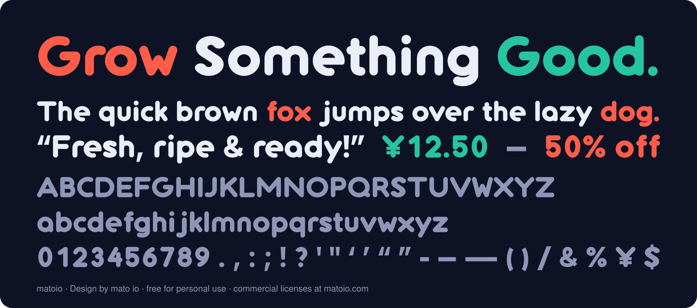

<picture>
  <source media="(prefers-color-scheme: dark)" srcset="matoio-logo-dark.svg">
  
</picture>

[English](README.md) · **简体中文**

# matoio 字体

圆润几何风格的展示字体，基于 matoio 标志的字形扩展而来。版本 1.000。
**个人免费使用，商业使用需到 [matoio.com](https://matoio.com) 购买授权。**



- **在线演示**：https://matoio.github.io/matoio-font/
- **设计**：by mato io
- **网站**：https://matoio.com
- **联系**：admin@matoio.com

## 授权

- **个人非商业使用：免费**。用于个人学习、练习、兴趣创作，前提是不产生收入。
- **商业使用：需购买授权**。只要用于公司、客户、带收入的作品、网站、App 或 Logo，都算商业使用。授权方式和价格见 **https://matoio.com**。
- **禁止**：转售或再分发字体文件、改名后再发布、制作与 matoio 标志相似的标识。
- 完整声明见 [`LICENSE`](LICENSE)。不确定某个用途是否需要授权，请先发邮件到 admin@matoio.com 确认。

## 文件

| 文件 | 用途 |
|---|---|
| `matoio-Regular.otf` | 桌面安装（推荐，设计软件里曲线最精确） |
| `matoio-Regular.ttf` | 桌面安装（兼容性最好，老软件也能用） |
| `matoio-Regular.woff2` | 网页使用（体积最小，约 6.5 KB；网页使用需购买网页授权） |
| `features.fea` | OpenType 功能的源码（字偶、数字切换），供以后修改字体时参考 |
| `LICENSE` | 许可声明（中英文）：个人免费，商用需购买授权 |
| `index.html` | 在线演示页，直接用 `matoio-Regular.woff2` 显示（GitHub Pages 用） |
| `images/preview.svg`、`images/preview.png` | README 和分享卡片用的预览图 |
| `matoio-logo.svg`、`matoio-logo-dark.svg` | matoio 标志（暗色版里 io 是白色） |

## 在线演示（GitHub Pages）

演示页 `index.html` 通过 GitHub Pages 发布在 **https://matoio.github.io/matoio-font/**（来源：`main` 分支根目录）。页面上的文字全部用 `matoio-Regular.woff2` 实时显示，可以直接试字。

## 安装

- **Windows**：右键 `.otf` 或 `.ttf` → **安装**（或"为所有用户安装"）。
- **Mac**：双击 `.otf` → 在"字体册"里点**安装**。
- 安装后在软件的字体列表里找 **matoio**。

## 网页使用

```css
@font-face {
  font-family: "matoio";
  src: url("matoio-Regular.woff2") format("woff2");
  font-display: swap;
}
body { font-family: "matoio", system-ui, sans-serif; }
```

字体里没有的字符（比如中文、€、@、#）会由后面的 `system-ui, sans-serif` 自动顶上。

## 包含的字符

- **字母**：a–z、A–Z（52 个）。
- **数字**：0–9，默认等宽，另附一套比例数字。
- **标点**：`. , : ; ! ? ' " ‘ ’ “ ” - – — ( ) / &`。
- **符号**：`% ¥ $`。
- **空格**：普通空格和不换行空格。
- **不包含**：中文、其他货币符号（€ £）以及 @ # * + = 等符号。排版时，系统会用默认字体显示这些字符。

标点采用"平切楔形"风格：逗号和引号是平切的斜梯形，横线是矩形，圆点和 i 的点一样大。它参照普通系统字体标点利落、低调的样子，用梯形、矩形、圆弧和直线从零画出，没有描摹或提取任何现有字体的轮廓。

## 字体功能

| 功能 | 作用 | 默认 | 网页写法 |
|---|---|---|---|
| `kern` 字偶 | 181 对组合自动收紧：149 对字母（比如 Ty、AV、To）加 32 对标点（比如 T.、Y,、L’、“A） | 开 | `font-kerning: normal;` |
| `tnum` 等宽数字 | 每个数字一样宽，价格、表格能对齐 | 开 | `font-variant-numeric: tabular-nums;` |
| `pnum` 比例数字 | 按形状决定宽窄，适合海报大标题 | 关 | `font-variant-numeric: proportional-nums;` |

在 Figma、Illustrator、InDesign 等软件里，比例数字可以在"OpenType"或"数字"面板里打开。

## 规格

- 每 em 1000 单位。
- 大写高 694，x 高 528。
- 上伸部 714，下伸部 −186。
- 笔画粗细 156（设计稿里的 78 放大 2 倍）。
- 行高参数：上 760、下 −240、行距 0，默认行高约 1.0 em。建议正文行高设 1.2–1.3。

## 已知限制

- **字符集**：只覆盖英文字母、数字和常用标点，其他字符由系统字体补上。在少数会把缺字显示成方框的软件里，需要手动给这些字符换字体。
- **字重**：只有一个字重（Regular，视觉上偏粗）。
